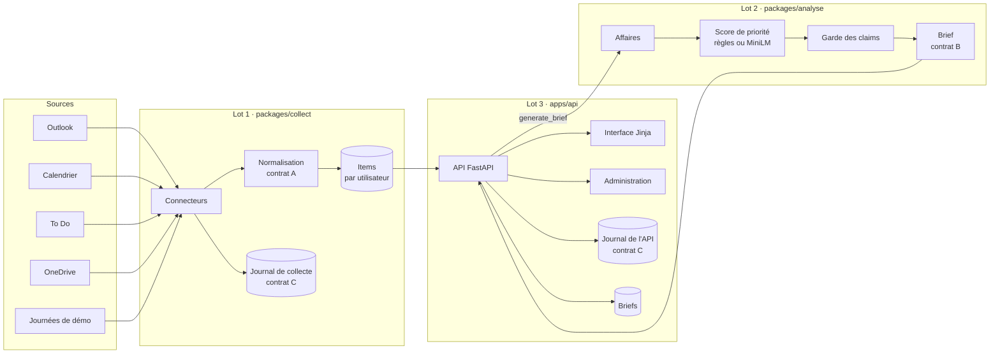

# Architecture (L3.9)

Agent de briefing quotidien : chaque matin, les mails, l'agenda, les tâches et les fichiers d'un
manager sont collectés, puis l'application produit sur demande un brief court, classé, dont chaque
entrée renvoie à sa source. Aucune dépendance à Copilot Studio ; tout service externe passe par
une interface remplaçable.

## Vue d'ensemble

## Le parcours d'une journée

1. **Collecte du matin** (lot 1, 8 h 30 heure de Paris, fenêtre des 24 h précédentes) : chaque
   connecteur actif lit sa source, convertit en Items (contrat A), et le lanceur écrit la journée
   dans `DATA_DIR/<user>/<jour>/items.jsonl` avec un événement de journal par source
   ([runner.py](../packages/collect/core/runner.py), [store.py](../packages/collect/core/store.py)).
   Une source en panne n'arrête pas les autres.
2. **Génération** (à la demande, `POST /briefs` ou bouton de l'interface) : l'API lit les Items
   du jour de l'utilisateur connecté et appelle `generate_brief` du lot 2
   ([briefs.py](../apps/api/src/alliance_api/briefs.py)). Le lot 2 regroupe les éléments en
   affaires, les note, choisit les entrées (7 au plus avec le score appris) et vérifie que chaque fait cite un élément réel
   ([brief.py](../packages/analyse/brief.py)). L'API vérifie à son tour que le brief est bien
   celui de l'utilisateur et que chaque item cité lui appartient, puis l'enregistre.
3. **Consultation** : l'interface affiche les sections dans l'ordre de priorité ; chaque entrée a
   son lien « Voir la source » (champ `url` du contrat A). Chaque génération et chaque lecture
   écrit un événement dans le journal de l'API.
4. **Administration** (L3.7) : un administrateur voit le journal filtrable, la chaîne d'un brief
   (collecte → génération → consultations) et les métriques techniques, jamais le texte des briefs.

## Contrats entre lots

Source de vérité : les modèles pydantic de [contracts/](../contracts/README.md), exportés en
JSON Schema et vérifiés en CI. Toute modification passe par une PR `contract-change`.

| Contrat | Objet | Produit par → lu par | Règles clés |
|---|---|---|---|
| A · `Item` | un mail, un événement, une tâche, un fichier | lot 1 → lots 2 et 3 | identifiant stable `source:id` ; dates avec fuseau ; `url` https obligatoire ; extrait ≤ 500 caractères ; corps complet jamais stocké |
| B · `Brief` | le brief du jour d'un utilisateur | lot 2 → lot 3 | sections `actions`, `meetings`, `overdue`, `files` ; chaque entrée et chaque claim citent leurs `source_item_ids` ; modèle et version du prompt dans `generator` |
| C · `AuditEvent` | un événement de journal | lots 1 et 3 → administration | identifiants et compteurs seulement ; toute adresse e-mail refusée ; `error_code` obligatoire en erreur |

## Responsabilités

| Dossier | Rôle | Lot |
|---|---|---|
| [packages/collect](../packages/collect/README.md) | connecteurs, OAuth Microsoft, normalisation, rétention, effacement | 1 |
| [packages/analyse](../packages/analyse/README.md) | affaires, score de priorité, sélection, garde anti-hallucination | 2 |
| [contracts](../contracts/README.md) | contrats A, B, C, fixtures, journées de démo | les 3 référents |
| `apps/api` | API, interface, authentification et droits, journal, administration | 3 |
| `eval` | jeux annotés, métriques, rapports d'évaluation | 3 |
| `infra`, `.github` | image Docker, compose, sauvegarde, CI | 3 |

## Interfaces remplaçables

Le code des routes ne connaît que des interfaces ; changer d'implémentation se fait au démarrage
(`create_app` dans [main.py](../apps/api/src/alliance_api/main.py)) ou par configuration.

| Interface | Implémentations | Choix |
|---|---|---|
| `Connector` (lot 1) | Graph (mail, calendrier, To Do, OneDrive), démo, notes | un dossier par source, découvert automatiquement |
| `BriefGenerator` | `generate_brief` du lot 2 ; briefs annotés (démonstration) | `DEMO_BRIEFS` |
| `ItemStore`, `BriefStore`, `AuditSink`, `FeedbackStore`, `SessionStore` | fichiers JSON Lines ou mémoire | `DATA_DIR`, `BRIEFS_DIR`, `AUDIT_DIR`, `FEEDBACK_DIR` |
| Fournisseur d'identité | OpenID Connect générique (Microsoft pour la démo) | `OIDC_*`, voir [auth.md](auth.md) |

## Technologies retenues

| Choix | Pourquoi | Décision |
|---|---|---|
| Python 3.12, uv, monorepo | une seule langue pour les 3 lots, dépendances verrouillées (`uv.lock`) | guide §4 |
| pydantic v2 pour les contrats | contrats exécutables, JSON Schema exporté, validation en CI | guide §2 |
| FastAPI + Jinja, sans JavaScript à construire | une équipe de 4 maintient une seule application ; mêmes contrôles pour l'interface et l'API | [ADR-0001](adr/0001-interface-jinja.md) |
| Microsoft Graph, lecture seule ; Google reporté | Microsoft complet et vérifié sur un vrai compte | [ADR-0004](adr/0004-google-reporte.md) |
| Contrat A 1.1 (`correlation_id`, `attributes`) | relier l'invitation reçue par mail à l'événement du calendrier | [ADR-0002](adr/0002-contrat-A-1.1.md) |
| Score de priorité : règles par défaut, MiniLM appris en option | caractéristiques lisibles, modèle local et déterministe | [ADR-0003](adr/0003-score-appris.md), [ADR-0005](adr/0005-modele-multi-sources.md) |
| Fichiers dans un volume, sans base de données | rien à migrer, sauvegarde par archive, effacement par dossier | [ADR-0006](adr/0006-stockage-fichiers.md) |
| Docker Compose, hors ligne | `docker compose up` suffit, modèle rangé dans l'image | [exploitation.md](exploitation.md) |
| OpenID Connect, sessions côté serveur | fournisseur interchangeable par configuration | [auth.md](auth.md) |
