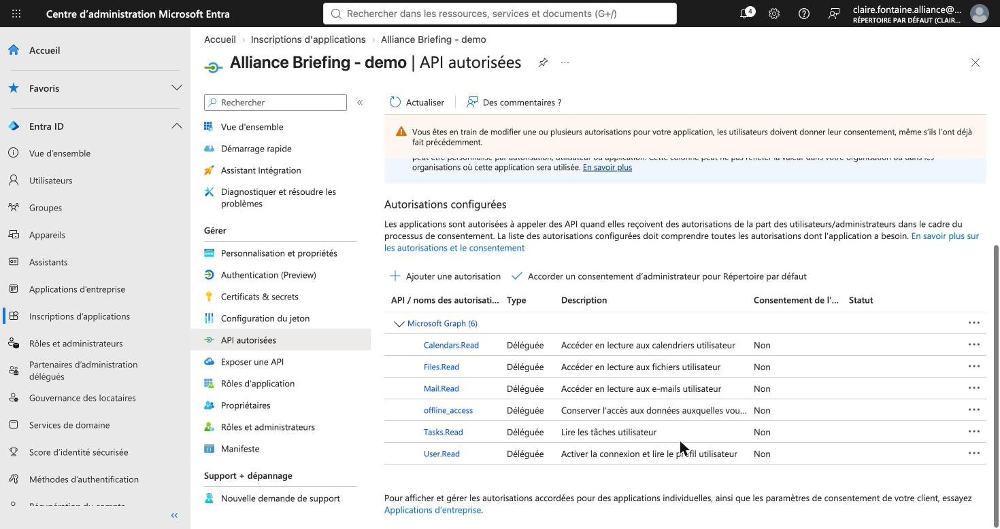

# Connexion Microsoft (OAuth, lot 1)

La collecte lit les mails, l'agenda, les tâches et les fichiers d'un compte Microsoft
**sans jamais connaître son mot de passe** : l'utilisateur se connecte chez Microsoft, qui
nous remet des jetons de lecture. Code : `packages/collect/core/oauth.py`.

## L'application enregistrée

| Réglage | Valeur |
|---|---|
| Nom | Alliance Briefing - demo (Entra, « Répertoire par défaut » du compte de démo) |
| ID d'application (client) | `2cc83c27-af71-4bfc-9338-52885df8f00d` — public, dans `collect.toml` |
| Comptes acceptés | tout locataire Entra + comptes Microsoft personnels (autorité `common`) |
| Redirection | client public, `http://localhost` (le port est choisi au lancement) |
| Secret client | **aucun** : PKCE (voir plus bas) |



## Autorisations demandées (déléguées, lecture seule)

| Autorisation | Pourquoi |
|---|---|
| `Mail.Read` | mails reçus de la semaine (L1.3) |
| `Calendars.Read` | réunions du jour (L1.1) |
| `Tasks.Read` | tâches Microsoft To Do (L1.4) |
| `Files.Read` | documents OneDrive récents (L1.5) |
| `User.Read` | adresse du compte, pour savoir ce qui lui est « adressé directement » |
| `offline_access` | jeton de renouvellement : collecte chaque matin sans reconnexion |

Aucune autorisation d'écriture, d'envoi ni « application » (accès sans utilisateur).

## PKCE en deux phrases

Un programme installé ne peut pas garder de secret. Au lancement, on tire un nombre secret
et on n'envoie à Microsoft que son empreinte : pour échanger le code reçu contre les jetons,
il faut présenter le nombre d'origine, qui n'a jamais quitté le programme. Un code
intercepté est donc inutilisable.

## Utilisation

```sh
uv run python -m packages.collect.auth keygen --save           # une fois : clé de chiffrement
uv run python -m packages.collect.auth login  --user u_claire  # navigateur → Microsoft
uv run python -m packages.collect.auth status --user u_claire
CALENDAR_SOURCE=graph uv run python -m packages.collect.cli --user u_claire --day 2026-11-17
uv run python -m packages.collect.auth logout --user u_claire  # efface les jetons
```

- **Jetons** : chiffrés (Fernet) dans `TOKENS_DIR/<user>.json.enc` (défaut
  `~/.local/share/alliance-briefing/tokens`), fichier en `0600`.
- **Clé** : variable `TOKEN_KEY`, sinon `~/.config/alliance-briefing/token_key` (`0600`).
  Jamais dans le dépôt ni dans un message. Perdue → `keygen --save` puis nouveau `login`.
- **Renouvellement** : automatique 5 min avant l'expiration ; le nouveau jeton de
  renouvellement remplace l'ancien.
- **Accès retiré ou expiré** : `get_access_token` lève `reauth_required` ; le runner en fait
  un warning, les autres sources continuent. Relancer `login`.
- **Révocation complète** : `logout`, puis retirer l'accord côté Microsoft
  (<https://account.live.com/consent/Manage> pour un compte personnel).
- **Jamais de jeton affiché** : ni dans les journaux, ni dans les erreurs (seul le code
  OAuth, ex. `invalid_grant`) ; vérifié par `tests/test_oauth.py`.
